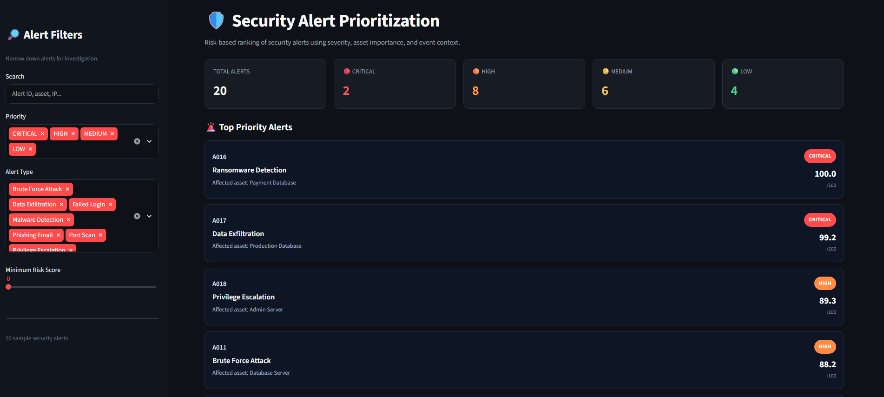
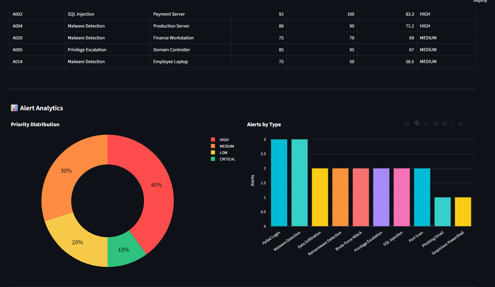
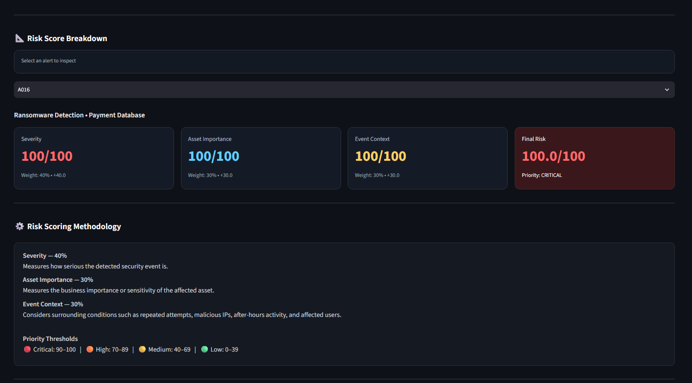

# Security Alert Prioritization Dashboard

A hands-on SOC-style mini-project that I created as part of an internship assignment to assist security analysts in triaging their alerts more quickly by use of a weighted risk score.
The dashboard processes raw security alerts and outputs a final risk score and assigns a priority level to each alert, and visualizes the data in an easy to understand Streamlit application to more quickly triage security alerts.

## Internship Task Context

The main objective was to demonstrate what a typical analyst scenario looks like when they get lots of alerts together and have to make sure that they are acted upon in the proper order. Rather than having a person going through alerting one-by-one, this project built some type of consistent rating that should push the alerting with higher risk level up.

## What This Project Does

- Calculates a weighted risk score for each alert.
- Assigns priority levels: `CRITICAL`, `HIGH`, `MEDIUM`, `LOW`.
- Provides filter/search controls for investigation.
- Shows top-priority alerts first (respecting the active filters).
- Displays analytics charts and score breakdown cards, including a plain-English "why this priority?" explanation.
- **Detects live threats**: a demo login app writes security logs, a detector finds brute-force attacks in them, and those alerts are scored and shown alongside the sample alerts.
- Exports the prioritized table to CSV.

## How the Pieces Fit Together

```text
demo_app/login_app.py --> logs/security.log --> log_collector --> detection --\
                                                                              >--> alert_pipeline --> scoring_engine --> app.py (dashboard)
                                           data/alerts.csv (sample alerts) --/
```

## Risk Scoring Logic

The final score is computed on a 0-100 scale:

`Risk Score = (Severity x 0.40) + (Asset Criticality x 0.30) + (Event Context x 0.30)`

### Event Context Inputs

Event context (0-100, capped) increases based on signals such as:

| Signal | Points |
|---|---|
| 5-9 failed attempts / 10-49 / 50+ | +15 / +25 / +35 |
| Malicious IP flag | +30 |
| After-hours activity | +15 |
| 5-9 affected users / 10+ | +10 / +20 |

A separate **Threat Score** (malicious IP and repeated failures) is shown as an extra analyst indicator. It is not part of the weighted formula.

### Priority Thresholds

- `CRITICAL`: 90-100
- `HIGH`: 70-89
- `MEDIUM`: 40-69
- `LOW`: 0-39

## Screenshots

### 1) Dashboard Home



### 2) Alert Analytics View



### 3) Risk Score Breakdown View



## Tech Stack

- Python
- Streamlit
- Pandas
- Plotly
- Flask (demo login app)

## Project Structure

```text
Security_Alert_Prioritization_System/
|-- app.py                    # Streamlit dashboard (UI)
|-- alert_pipeline.py         # Loads, validates, merges and scores alerts
|-- scoring_engine.py         # Risk / threat scoring and priority logic
|-- requirements.txt
|-- data/
|   |-- alerts.csv            # 20 sample alerts
|-- detection/
|   |-- threat_detector.py    # Brute-force detection from login logs
|-- log_collector/
|   |-- log_reader.py         # Reads logs/security.log
|-- demo_app/
|   |-- login_app.py          # Flask login page that generates security logs
|   |-- simulate_attack.py    # Sends failed logins to trigger the detector
|-- logs/
|   |-- security.log          # Written by the demo app
|-- tests/                    # Unit tests
|-- assets/                   # Screenshots
```

## Run Locally

1. Clone or open the project folder.
2. (Recommended) create and activate a virtual environment, then install dependencies:

```bash
pip install -r requirements.txt
```

3. Start the dashboard:

```bash
streamlit run app.py
```

4. Open the local URL shown in terminal (usually `http://localhost:8501`).

### Try the live detection demo

Open three terminals in the project folder:

```bash
python demo_app/login_app.py          # 1) login page at http://127.0.0.1:5000
python demo_app/simulate_attack.py    # 2) sends 8 failed logins (or type wrong passwords yourself)
streamlit run app.py                  # 3) refresh the dashboard: a "Brute Force Attack" alert appears
```

Demo login: `admin` / `Admin@123` (override with the `DEMO_USERNAME` and `DEMO_PASSWORD` environment variables).
Use the **Include live alerts** checkbox in the sidebar to switch the live alerts on or off.

You can also run the detector on its own: `python detection/threat_detector.py`

## Run the Tests

```bash
python -m unittest discover -v
```

## Notes

- The sample dataset is for demonstration.
- Scoring weights and thresholds are constants at the top of `scoring_engine.py` and can be tuned to SOC policy.
- Brute-force rule: 5 or more failed logins for the same user and IP within 10 minutes (see `detection/threat_detector.py`).
- The demo app is for local testing only. It binds to `127.0.0.1` and keeps Flask debug mode off unless `FLASK_DEBUG=1` is set.
- Values from logs are untrusted, so they are HTML-escaped in the dashboard and neutralised in CSV exports.

## Future Improvements

- Export to PDF.
- Integrate real-time alert ingestion from a SIEM.
- Add authentication for role-based access.
- More detection rules (port scans, privilege escalation, impossible travel).

---

Developed as an internship task to demonstrate risk-based alert triage and dashboard reporting.
